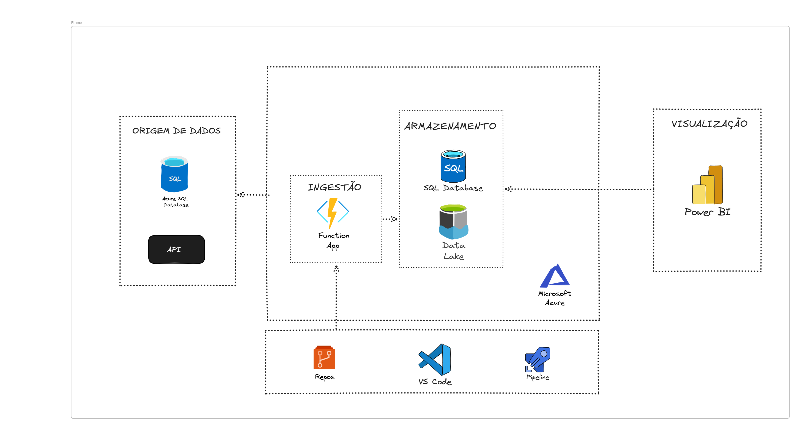

# TAPRC-2026

Projeto acadêmico da disciplina — Azure Functions com **Timer Trigger** e **HTTP Trigger**, incluindo comunicação entre functions.

## 👥 Integrantes

- Ana Paula de Souza
- Ellen Beatriz
- Milena Damasia
- Thaynara Peron

## 👥 Turma
144-6C

## 🖼️ Diagrama

## Carga diária do ITSM

A Function extrai as tabelas `itsm` para CSV no container `bronze` e, em seguida,
carrega os arquivos no banco de destino:

- Extração: diariamente às 04:00 UTC (01:00 no horário de Brasília).
- Carga: diariamente às 05:00 UTC (02:00 no horário de Brasília).

Configure no Function App as variáveis de ambiente da origem
(`HOST`, `DATABASE`, `USER`, `PASSWORD` e `DATALAKE_CONNECTION_STRING`) e do
destino (`DEST_HOST`, `DEST_DATABASE`, `DEST_USER` e `DEST_PASSWORD`). Não
armazene credenciais no código nem neste README.

A carga exige os CSVs das dez tabelas da mesma execução diária. Ela preserva os
IDs da origem e atualiza ou insere usando as chaves primárias do destino. Como
usa `SET IDENTITY_INSERT`, o usuário SQL do destino precisa ter permissão para
inserir IDs explícitos nas tabelas. A carga é transacional: uma falha reverte a
execução inteira.

Para validar sem esperar o horário diário, publique a Function e use **Test/Run**
no Portal: execute primeiro `extract_itsm_tables`, aguarde a conclusão e depois
execute `load_itsm_tables`. Confira o resultado em **Monitor** e os logs no
Application Insights. A tabela `itsm.csat` não faz parte da extração atual.
